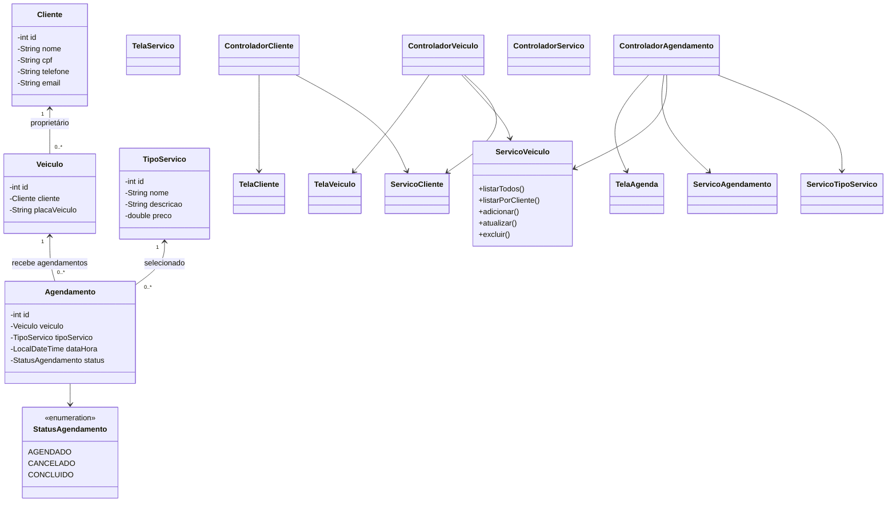

# Diagramas UML

Os diagramas também estão disponíveis nos arquivos `.puml` para edição no PlantUML.

## 1. Diagrama de Classes



**Relacionamento principal:** um cliente pode possuir vários veículos (`1:N`). Cada veículo pertence a um único cliente. Cada agendamento é feito para um veículo específico.

## 2. Diagrama de Sequência — Agendamento

```mermaid
sequenceDiagram
    actor Usuario
    participant View as TelaAgenda
    participant Controller as ControladorAgendamento
    participant Service as ServicoAgendamento
    participant Model as Agendamento

    Usuario->>View: Seleciona veículo, serviço e data/hora
    Usuario->>View: Clica em Agendar
    View->>Controller: Evento do botão
    Controller->>View: Obtém os dados preenchidos
    View-->>Controller: Veiculo, TipoServico e LocalDateTime
    Controller->>Service: agendar(veiculo, serviço, dataHora)
    Service->>Service: Valida dados e verifica conflito

    alt Horário disponível
        create participant Model
        Service->>Model: Cria Agendamento
        Service-->>Controller: Agendamento criado
        Controller->>Service: listarTodos()
        Service-->>Controller: Lista atualizada
        Controller->>View: Atualiza JTable
        View-->>Usuario: Exibe confirmação
    else Horário ocupado ou dados inválidos
        Service-->>Controller: Erro de validação
        Controller->>View: Exibe mensagem de erro
        View-->>Usuario: Solicita correção
    end
```
