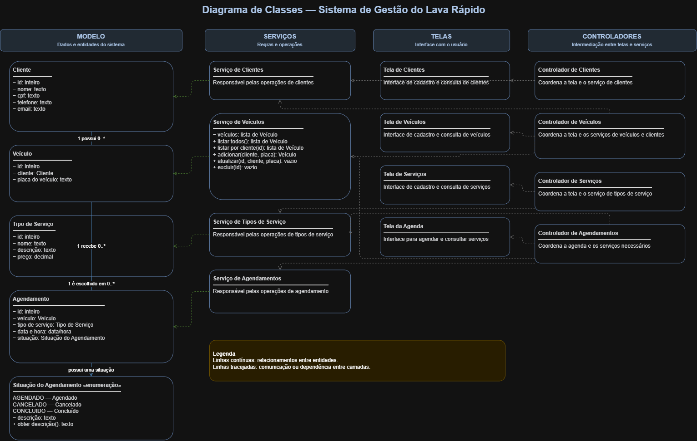
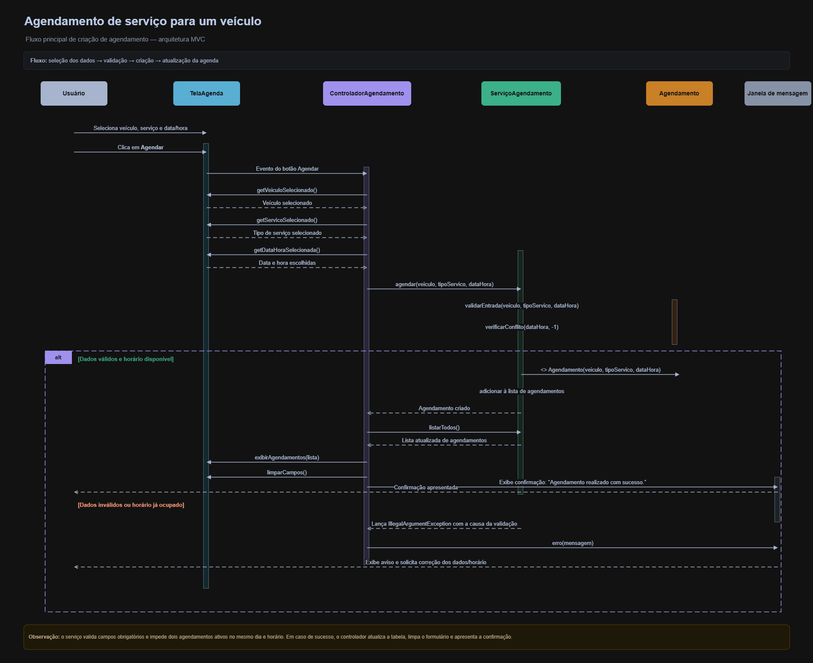

# Diagramas do Sistema de Gestão de Lava Rápido

Esta pasta contém os diagramas UML do projeto, utilizados para representar sua estrutura e seu funcionamento.

## 1. Diagrama de Classes

Representa as classes do sistema, seus atributos, métodos e relacionamentos.

**Arquivo editável:** [Diagrama de Classes](Diagrama_de_Classes.drawio)

---

## 2. Diagrama de Sequência

Representa o fluxo de agendamento de serviços e a comunicação entre as partes do sistema.

**Arquivo editável:** [Diagrama de Sequência](Diagrama_de_Sequencia.drawio)
